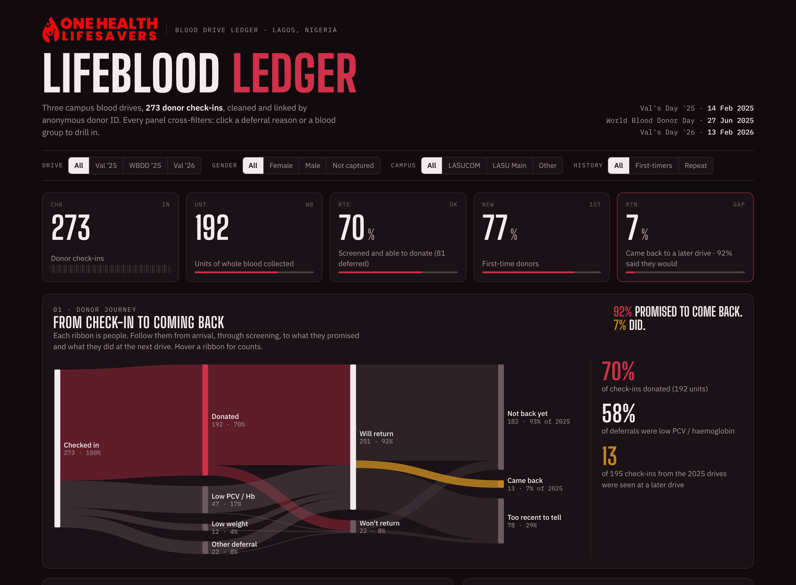
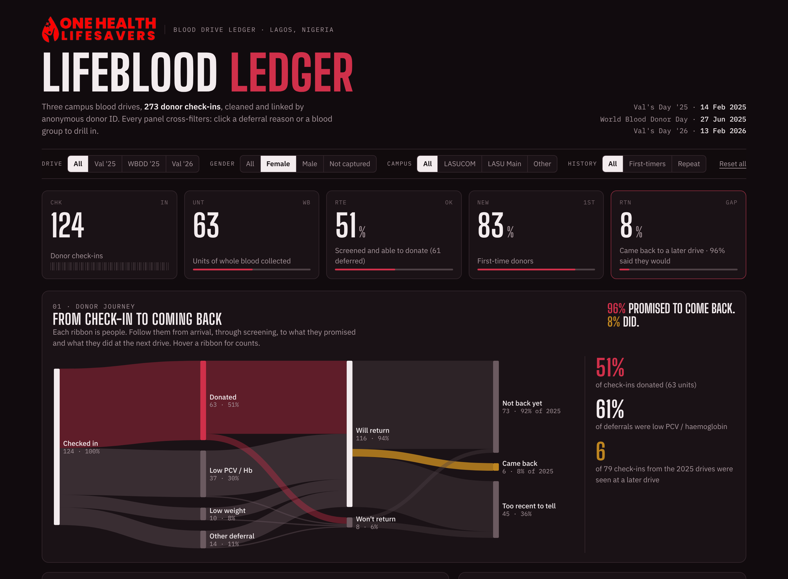
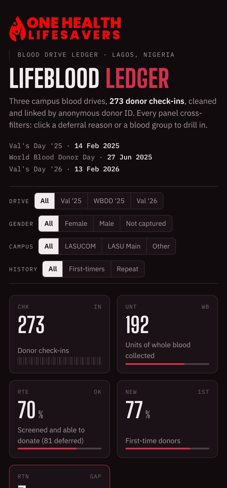

<p align="left"></p>

# Lifeblood Ledger

An end-to-end analysis of three campus blood drives run by **One Health Lifesavers** in Lagos, Nigeria, covering 281 raw survey responses that were cleaned, anonymised and modelled, then turned into an interactive dashboard and a Power BI kit.

**[Open the live dashboard →](dashboard/index.html)** (run it locally, or turn on GitHub Pages; see [Run it](#run-it))



## The headline

**92% of donors promised to come back. 7% did.**

| Finding | Number |
|---|---|
| Donor check-ins across 3 drives | **273** |
| Units of whole blood collected | **192** (70% of check-ins) |
| Deferrals caused by low PCV / haemoglobin | **58%** |
| Deferral rate, women vs men | **49% vs 6%** |
| Check-ins from 2025 drives seen at a later drive | **13 of 195 (7%)** |
| Donors who didn't know their blood group | **32%** |

### What the data says to do
1. **Pre-screen haemoglobin before drive day.** Low PCV/Hb drives most deferrals and hits women hardest. A finger-prick check and iron-nutrition message the week before would cut wasted trips.
2. **Turn promises into return visits.** 92% opted in to reminders, so send SMS reminders 7 days and 1 day before the next drive and track who shows.
3. **Give donors their blood group.** A third don't know it. Sharing the result is a cheap reason to come back.
4. **Fix the form.** Use dropdowns for reason and campus, make gender required from the start, and add a drive selector.

## The dashboard

Built as a single HTML page with D3. Everything is clickable: the filter bar, every bar, vial and journey stage, and each group row (Female, 18-19, First-timer…). One click redraws the whole page for that slice, and filters stack. Keyboard users can Tab to any of them and press Enter.

| Panel | What it shows |
|---|---|
| Donor journey | Sankey from check-in → screening outcome → stated intent → actual return |
| Why donors are turned away | Deferral reasons (clickable filter) |
| Deferral rate by group | Gender, age band, first-timer vs repeat |
| Blood group vials | Check-ins and donations per ABO/Rh group (clickable filter) |
| Drive-day pulse | Submissions per hour on an ECG-paper grid |
| Who came back | Drive-to-drive retention matrix |
| How it felt | Sentiment and quotes from Val's Day '26 |
| What to do next | Recommendations whose numbers update with the filters |

<table><tr>
<td><br><sub>Filtered to female donors: donation rate drops to 51%.</sub></td>
<td width="28%"><br><sub>Responsive down to phone width.</sub></td>
</tr></table>

Light mode: [docs/img/hero-light.png](docs/img/hero-light.png) · Full page: [docs/img/dashboard-full-dark.png](docs/img/dashboard-full-dark.png)

## The process

```
data/raw/ (3 Google Form .xlsx, private)  ──►  src/clean.py  ──►  data/cleaned/*.csv  ──►  src/build_dashboard.py  ──►  dashboard/index.html
                                                                                    └──►  powerbi/ (theme, DAX, build guide)
```

### 1. Harmonise
The three forms asked different questions with different column names and orders (for example, `Institution / Organisation`, `Institution / Organisation e.g LASU`, `Institution `). All were mapped to one schema.

### 2. Anonymise
- Names, emails and phone numbers are dropped.
- People are matched across drives by joining on phone number **or** email (union-find), then given a sequential `donor_id` (`D-0001`…). No hash of personal data is kept, so IDs can't be reversed.
- Timestamps are rounded to the minute, and rare occupations are generalised to "Non-student".

### 3. Clean
All 16 fixes are logged with row counts in [`data/cleaned/data_quality_log.csv`](data/cleaned/data_quality_log.csv). The main ones:

| Issue | Rows | Fix |
|---|---:|---|
| Responses submitted on the wrong drive's form | 7 | Re-assigned to the correct drive by timestamp |
| Same person submitted twice in one drive | 8 | Kept latest |
| Institution typed 42 different ways | 42 variants | Grouped into 5 campuses |
| Deferral reason written 73 free-text ways | 73 variants | Classified into 7 reasons with ordered regex rules |
| Gender question added mid-drive | 69 | Labelled "Not captured" rather than guessed |
| Ages of 99 and 100 | 2 | Set to blank |
| "First-time donor = Yes" but "donated once before" | 2 | Treated as first-time |

### 4. Model
A small star schema, ready for Power BI or any BI tool:

- `fact_responses.csv` has one row per check-in (273 rows).
- `dim_drive.csv` has one row per drive.
- `dim_donor.csv` has one row per person (260), with drives attended and donations given.

The field-by-field reference is in [`docs/data-dictionary.md`](docs/data-dictionary.md).

### 5. Build
`src/build_dashboard.py` embeds the cleaned data into `src/dashboard_template.html` to produce a self-contained `dashboard/index.html`. The Power BI version is in [`powerbi/`](powerbi/): a matching theme, about 20 DAX measures (including the return-gap logic), and a page-by-page build guide.

## Run it

```bash
pip install pandas openpyxl
python src/build_dashboard.py          # rebuilds dashboard/index.html from data/cleaned
# python src/clean.py                  # only if you have the raw exports in data/raw/
```

Open `dashboard/index.html` in a browser. To host it, go to **Settings → Pages → Deploy from branch → `main` / root**. The dashboard will then be at `https://<user>.github.io/<repo>/dashboard/`.

## Limits
- These are self-reported, post-donation survey answers, not clinical records. Deferral reasons are as donors recalled them.
- Submission hour is when the evaluation form was filled in, so it is used as a proxy for clinic flow.
- Return is only measurable for the two 2025 drives. Val's Day '26 is the latest drive.
- People are matched across drives by phone or email. Someone who changed both would be counted as a new donor.

## Credits
Data: One Health Lifesavers (personal data removed before publishing). Logo © One Health Lifesavers.
Cleaning, analysis and dashboard: **Qais Adeniji-Bello**.
